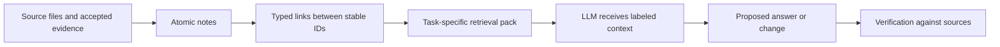
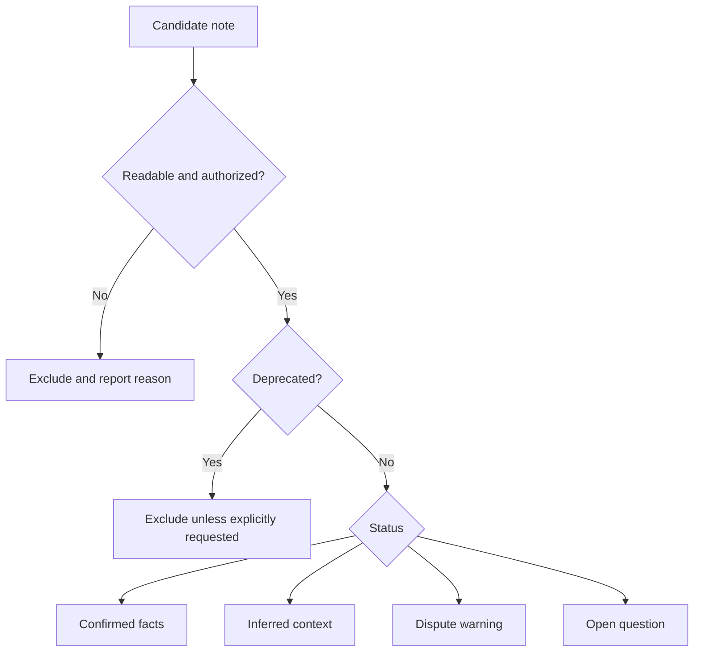

# Architecture and information contracts

## The proposed pipeline

This is a design flow, not an executable deployment diagram. No process, port, queue or network endpoint in it is implemented here. Its reliability depends on preserving the difference between evidence, interpretation and action.

## Note schema

The required frontmatter fields are `id`, `type`, `status`, `confidence`, `source`, `links`, and `last_verified`. Frontmatter is the metadata block between opening and closing `---` lines at the beginning of a Markdown document. The note body supplies the actual claim and enough local context to understand it without opening every linked note.

| Field | Contract and maintenance implication |
|---|---|
| `id` | Stable identity. Rename the display title without casually changing this ID. |
| `type` | One of decision, constraint, gotcha, workflow, domain-fact, open-question or runtime-memory. This classifies the claim's purpose. |
| `status` | confirmed, inferred, disputed, deprecated or open-question. This controls how retrieval should present it. |
| `confidence` | high, medium or low. High confidence is not a substitute for provenance or current verification. |
| `source` | A list of source pointers. A parser should verify these are well formed and meaningful in the receiving project. |
| `links` | Wiki-style links using stable IDs. The examples use `[[related-note-id]]`. |
| `last_verified` | A date. It indicates when evidence was checked, not an automatic expiration policy. |

There is a useful unresolved detail: the README's YAML example writes unquoted wiki links. YAML parsers may interpret brackets as collection syntax rather than strings. Before building a parser, choose a strict serialization and fixtures, for example quoted link strings. Document that choice rather than assuming every frontmatter parser accepts the illustrative syntax identically.

## Retrieval behavior

The skill requests directly matched notes, one-hop expansion of links, provenance and status metadata, deprecated-note exclusion by default, and warnings for disputed information. A one-hop expansion means follow a direct link once; it does not mean recursively load the entire graph. The references additionally say to keep the pack small and prefer confirmed, high-confidence notes.

The output reference separates Canon Facts, Inferred Notes, Disputed Notes and Open Questions. The runtime reference also names Recent Events. These are compatible purposes but not a complete executable selection algorithm. There are no specified scoring weights, byte/token budgets, tie breakers, permission filters or link-cycle algorithms. Those are real design gaps, not hidden defaults.

The permission check in this diagram is a required design consideration for a future implementation, not an implemented feature of this repository. The current documents do not define an authorization engine.

## Runtime storage proposal

`runtime_memory.md` proposes `session_events`, `memory_notes`, `memory_links`, and optional embeddings. Events retain evidence; notes distill it; links relate notes; embeddings help find candidates. Embeddings must remain a derived retrieval aid, since a similarity result cannot establish truth. Narrative generation should not directly mutate accepted canon: extraction and validation must intervene. No SQL schema, API or database implementation for these proposed names is committed.
