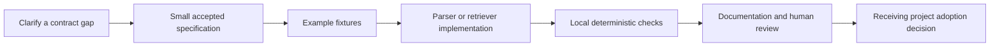

# Developing the design into a reliable implementation

## Recipe: resolve the link representation

Begin with `note_schema.md`, the README example and the skill's example. Choose whether links are strings containing wiki syntax or a structured list of IDs. Add fixtures showing a valid note, a quoted link, missing metadata, an unknown status, duplicate IDs and a dangling link. Define whether invalid notes fail a build or are omitted with a visible diagnostic. Then update every example to the same representation. Acceptance is reproducible parsing and clear rejection, not merely that a Markdown renderer displays the text.

This is a proposed implementation recipe. The current repository has no parser test harness, so adding one is real new product work and needs an explicit language/toolchain decision. Prefer a small portable validator before designing an entire database or user interface.

## Recipe: define deterministic retrieval

Specify matching inputs, maximum output size, stable ordering, permission boundaries, status routing and one-hop expansion before writing code. Create fixtures with a link cycle, two equal matches, an inferred note linked to a confirmed note, a deprecated note and a disputed amendment. The expected pack should be byte-for-byte stable for the same inputs. A linked confirmed note must not promote its inferred neighbor to canon. A missing source should produce an explicit problem rather than disappear unnoticed.

## Recipe: define corrections before runtime integration

A runtime implementation must specify who can confirm a note, how an event is linked, whether old facts are superseded or deleted, and how a failed update is recovered. Write scenarios for “user corrected a fact,” “source became unavailable,” “two authorized sources disagree,” and “retrieval index was rebuilt.” Storage and retrieval must honor the same scope. Test canon changes separately from narrative generation.

Keep raw evidence access distinct from the compact pack. A source pointer should permit an authorized reviewer to investigate a claim, but should not automatically expose private content to every consumer. The present pattern needs an explicit privacy/access model before it is suitable as a multi-user runtime product.

## Maintaining the skill

The skill is source material in this repository, not a secretly installed agent setting. Changes to its instructions should be reviewed as behavior changes: a new default vault location or automatic mutation rule can affect every adopter. Keep the description narrow enough to distinguish documentation design from actual memory-server operation. Update references together, preserve historical evidence where useful, and state migration implications for any future schema change.
